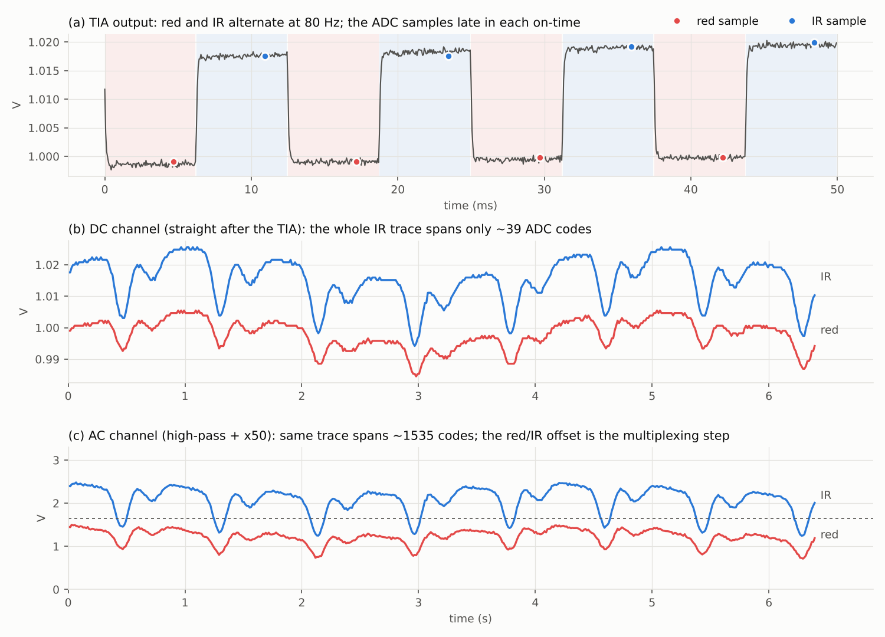
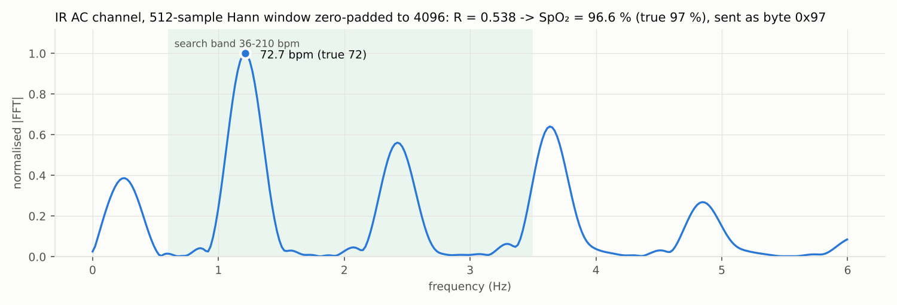
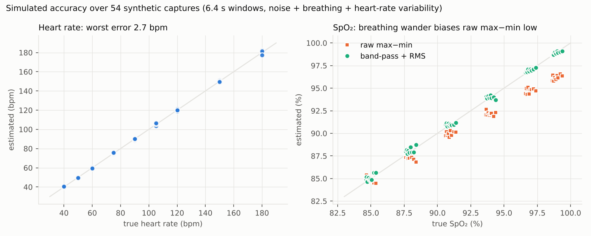
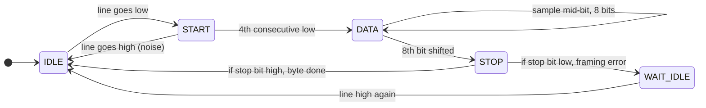
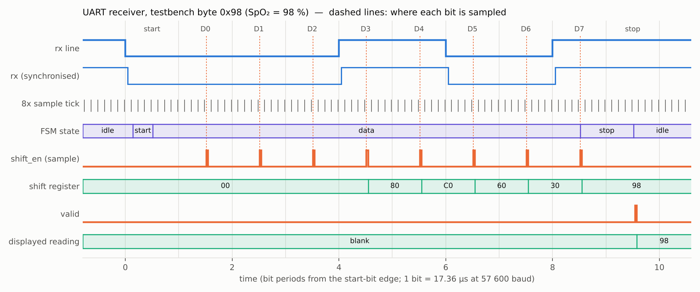
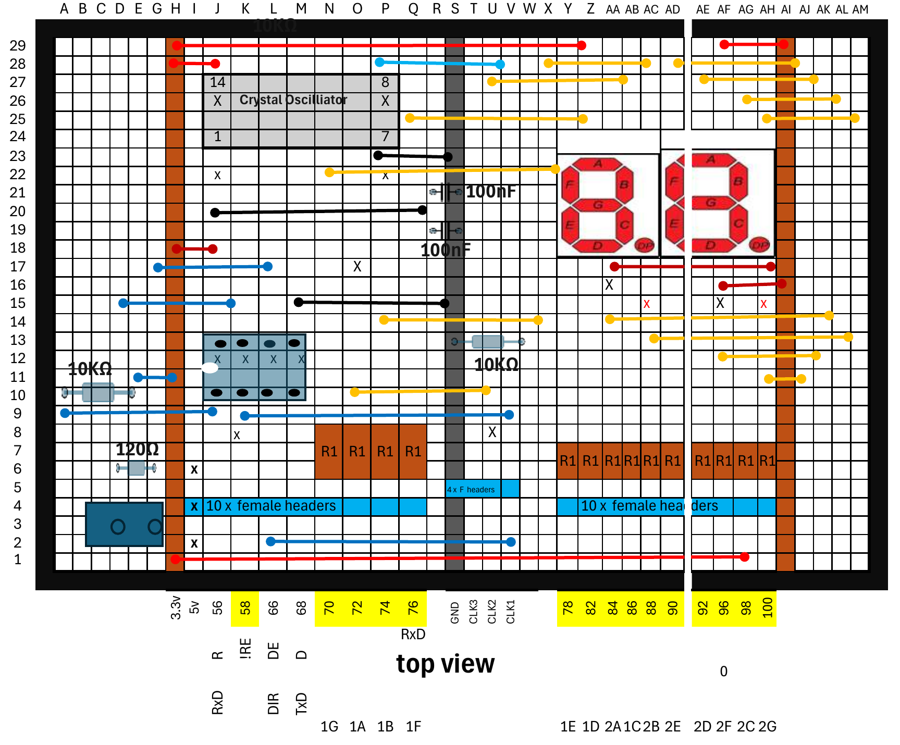

<div align="center">

  <h1>Pulse Oximeter with a Remote Display</h1>

  <p>
    A finger-clip pulse oximeter that measures heart rate and SpO2 on an STM32 and sends the reading over RS-485 to a CPLD display board.
  </p>

<p>
  <a href="LICENSE">
    
  </a>
  <a href="https://github.com/Onafuwadav/pulse-oximeter/actions/workflows/ci.yml">
    
  </a>
</p>

<h4>
  <a href="https://onafuwadav.github.io/">Try the simulation in my portfolio</a>
</h4>
</div>


## About the Project

A pulse oximeter that measures heart rate and blood oxygen built as group project at the University of Nottingham. It has three parts:

* **Sensor board:** A red/infrared LED shines through the fingertip. A photodiode amplifier turns the light into a steady DC signal and an amplified pulse AC signal
* **Processing:** An STM32 samples both signals on timer-triggered ADCs, finds the heart rate with an FFT and works out SpO2 from the ratio of red to infrared
* **Display board:** The readings are sent over RS-485 to a second board, where a CPLD decodes the serial data and drives the display

### My Role

* **Every stage of the build.** The team rotated roles, so I worked on the sensor circuit, the STM32 firmware and the CPLD display board.
* **Expanded on outside of project** I added a Python simulation of the whole signal chain and a VHDL rewrite of the display logic tested in GitHub Actions CI

<details>
  <summary>System overview</summary>

```mermaid
flowchart LR
  TT["PWM timer<br/>+ ADC trigger"]
  subgraph S[Sensor board]
    direction TD
    LED["Red/IR LED"] --> PD["Photodiode"]
    PD --> TA["Transimpedance amp"]
    TA --> HP[High pass filter] --> A[2nd stage amp]
  end
  subgraph P[STM32 processing]
    direction TD
    ADC["Two ADCs"] --> DSP["FFT heart rate<br/>red/IR SpO2"]
  end
  subgraph D[Display board]
    direction TD
    UART["CPLD<br/>UART receiver"] --> SEG["Display"]
  end
  TT --> S & P
  S -->|"DC: TIA -> ADC #1<br/>AC: 2nd amp -> ADC #2"| P
  P -->|"RS-485<br/>57,600 baud"| D
  ```

</details>

### Tech Stack

[![C][c-badge]][c-url] [![STM32][stm32-badge]][stm32-url] [![VHDL][vhdl-badge]][vhdl-url] [![Quartus][quartus-badge]][quartus-url] [![Python][python-badge]][python-url] [![pytest][pytest-badge]][pytest-url] [![GitHub Actions][actions-badge]][actions-url]


## Getting Started
 
### Prerequisites
- Python 3
- [GHDL](https://github.com/ghdl/ghdl) or [nvc](https://github.com/nickg/nvc) for VHDL testbenches
- Optional: STM32CubeIDE to build the firmware

### Installation
```bash
git clone https://github.com/Onafuwadav/pulse-oximeter.git
cd pulse-oximeter
python3 -m pip install -r sim/requirements.txt 
```
 
### Run locally
```bash
cd sim
python3 run_demo.py 
```
 
### Tests
```bash
cd sim
python3 -m pytest
cd hdl
make              # SIM=nvc (GHDL is default)
```


## Results

| simulation | Mean Error | Worst Error |
|---|---|---|
| Heart rate 40 to 180 bpm | mean error 0.58 bpm | worst 2.69 bpm |
| SpO2 85 to 99% | mean error 0.17% | worst 0.74% |
| VHDL testbench | 131 checks pass | |

<details>
  <summary>Simulated signal acquisition</summary>
The LED switches between red and infrared and the ADC samples each once the amplifier has settled. The DC channel straight after the transimpedance amp barely moves so a high-pass filter and a 2nd stage amplifier give the AC channel more codes to work with
 

 
</details>

<details>
  <summary>Heart rate with FFT</summary>
512 samples of the IR AC channel are zero-padded to 4,096 points then transformed with an FFT. The heart rate is the strongest peak between 36 and 210 bpm
 

 
</details>


<details>
  <summary>How SpO2 is worked out</summary>

Oxygenated and deoxygenated blood absorb red and infrared light differently, so comparing how strongly the pulse shows up at each wavelength gives the oxygen level:

```
R = (AC_red / DC_red) / (AC_IR / DC_IR)
SpO2 = 110 - 25 x R   [%]
```

Dividing each pulse by its own steady level cancels out LED brightness, skin and amplifier gain.



</details>

<details>
  <summary>Display board: UART receiver</summary>
The CPLD samples the RS-485 line 8 times per bit. A state machine finds the start bit, samples each data bit in the middle, checks the stop bit, then shows the received byte on display
 

 
The VHDL testbench receiving 0x98 (SpO2 = 98%), with the dashed lines showing where each bit is sampled:
 

 
</details>
<details>
  <summary>Display board layout</summary>
  
The team's stripboard layout for the display board:
 

 
</details>

## Contact

David Onafuwa: [LinkedIn](https://www.linkedin.com/in/david-onafuwa) · [Donafuwa@outlook.com](mailto:Donafuwa@outlook.com)

<!-- Tech stack badges -->
[c-badge]: https://img.shields.io/badge/C-A8B9CC?style=for-the-badge&logo=c&logoColor=black
[c-url]: https://en.cppreference.com/w/c
[stm32-badge]: https://img.shields.io/badge/STM32-03234B?style=for-the-badge&logo=stmicroelectronics&logoColor=white
[stm32-url]: https://www.st.com/en/development-tools/stm32cubeide.html
[vhdl-badge]: https://img.shields.io/badge/VHDL-4B4B4B?style=for-the-badge
[vhdl-url]: https://en.wikipedia.org/wiki/VHDL
[quartus-badge]: https://img.shields.io/badge/Quartus_Prime-0071C5?style=for-the-badge&logo=intel&logoColor=white
[quartus-url]: https://www.intel.com/content/www/us/en/products/details/fpga/development-tools/quartus-prime.html
[python-badge]: https://img.shields.io/badge/Python-3776AB?style=for-the-badge&logo=python&logoColor=white
[python-url]: https://www.python.org/
[pytest-badge]: https://img.shields.io/badge/pytest-0A9EDC?style=for-the-badge&logo=pytest&logoColor=white
[pytest-url]: https://pytest.org/
[actions-badge]: https://img.shields.io/badge/GitHub_Actions-2088FF?style=for-the-badge&logo=githubactions&logoColor=white
[actions-url]: https://github.com/features/actions
