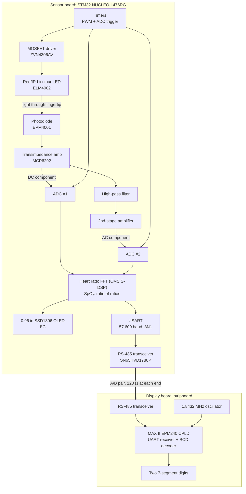
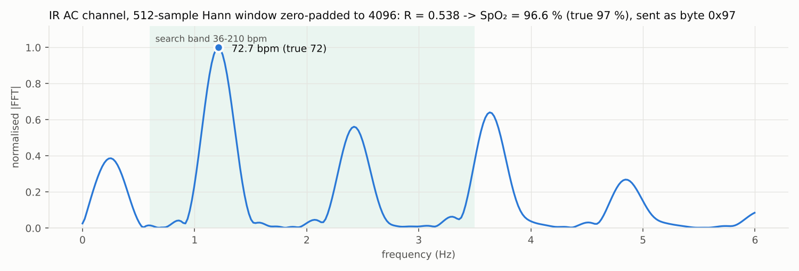
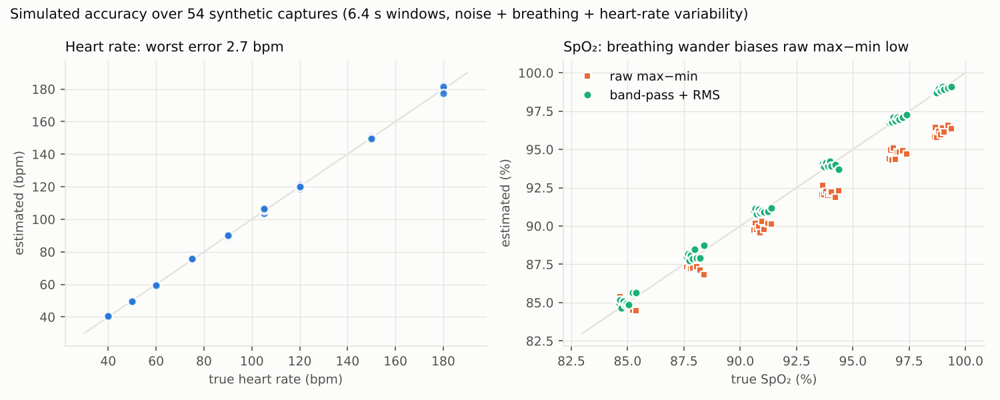
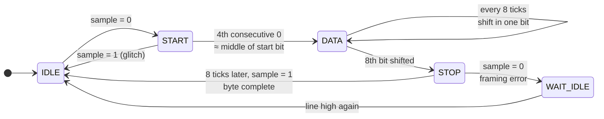
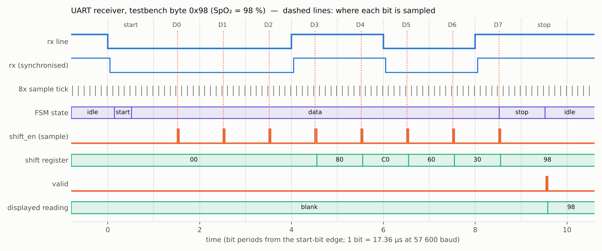
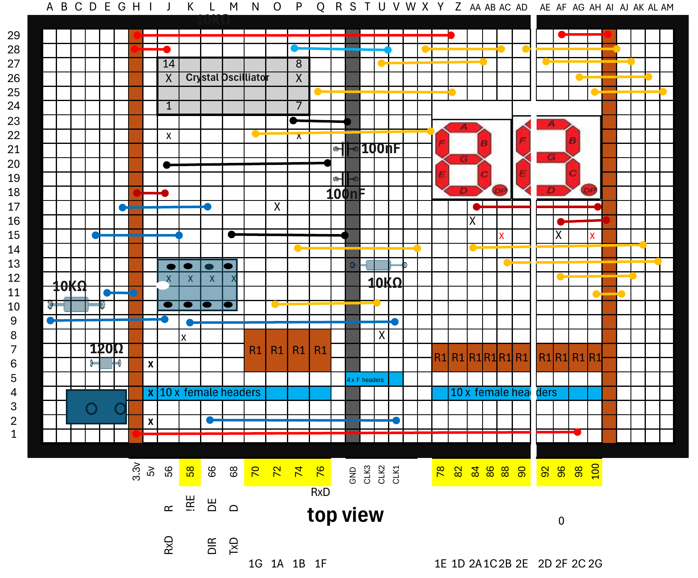
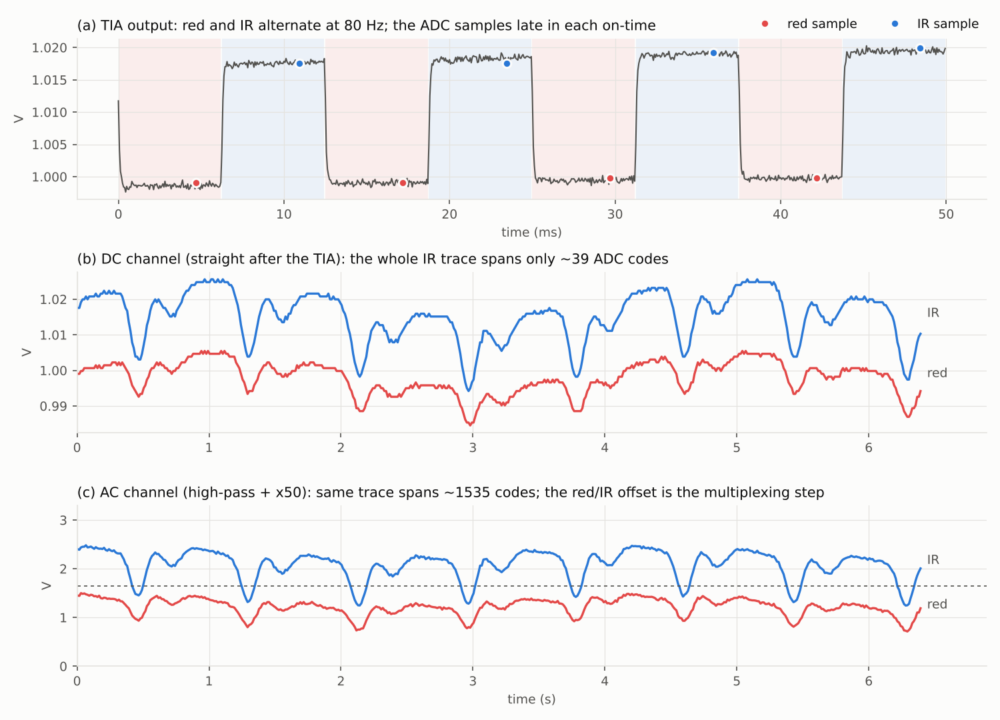

# Pulse oximeter with a remote display

[](https://github.com/Onafuwadav/pulse-oximeter/actions/workflows/ci.yml)

**EEEE2070 Electronic Systems Group Design Project · University of Nottingham · 2024–25 · Group 39**

A finger-clip pulse oximeter that measures **heart rate** and **blood-oxygen saturation (SpO₂)**. A Red/IR LED shines through the fingertip, a photodiode front end turns the light into two analogue signals, and an STM32 samples them, computes heart rate by FFT and the SpO₂ by R-value calculation, and shows both on an OLED. The SpO₂ reading is also sent over an RS-485 link to a separate display board, where the CPLD decodes the serial stream and drives two seven-segment digits.

Heart rate and SpO₂ both worked in the final demo.

## Contents

- [System overview](#system-overview)
- [Design notes by stage](#design-notes-by-stage)
  - [LED drive and modulation](#1-led-drive-and-modulation)
  - [Photodiode amplifier and filtering](#2-photodiode-amplifier-and-filtering)
  - [ADC timing and Nyquist](#3-adc-timing-and-nyquist)
  - [Heart rate by FFT](#4-heart-rate-by-fft)
  - [SpO₂ maths](#5-spo-maths)
  - [OLED output](#6-oled-output)
  - [RS-485 link](#7-rs-485-link)
- [Firmware architecture](#firmware-architecture)
- [CPLD display board](#cpld-display-board)
- [Results](#results)
- [My role](#my-role)
- [Lessons learned and what I'd do differently](#lessons-learned-and-what-id-do-differently)
- [Reference implementation](#reference-implementation)
- [Repository layout](#repository-layout)

## System overview


| Stage | Part | Job |
|---|---|---|
| Light source | ELM4002 bicolour LED, ZVN4306AV MOSFET | Red and IR light, alternated by PWM at about 80 Hz |
| Detector | EPM4001 photodiode, MCP6292 op-amp | Photocurrent to voltage (TIA), then high-pass filter and second gain stage |
| Processing | STM32L476RG (NUCLEO-L476RG), STM32CubeIDE, HAL, CMSIS-DSP | Two timer-triggered ADCs; FFT heart rate; ratio-of-ratios SpO₂ |
| Local display | SSD1306 128×64 OLED over I²C | Heart rate, SpO₂ and the pulse waveform |
| Link | SN65HVD1780P RS-485 transceiver | One byte per reading at 57 600 baud |
| Remote display | Altera MAX II EPM240, 1.8432 MHz crystal oscillator | UART receiver and BCD-to-7-segment decoder driving two digits |

## Design notes by stage

### 1. LED drive and modulation

The ELM4002 holds a red and an infrared emitter in one two-lead package; which one lights depends on the direction of the current. Using one package for both wavelengths means both beams take the same path through the finger, which matters because SpO₂ is computed from a comparison of the two.

A ZVN4306AV N-channel MOSFET, switched by the timer's PWM, carries the LED current so it doesn't come from a GPIO pin. Red and IR are switched on alternately at about 80 Hz, so a single photodiode sees a time-multiplexed signal (red level, IR level, red level, …). Each LED's on-time has to be long enough for the amplifier to settle before the sample is taken.

PWM is set by the timer prescaler (PSC) and auto-reload register (ARR). On the L476RG with the 80 MHz system clock:

```
f_PWM = f_clk / ((PSC + 1) × (ARR + 1))        duty = CCR / (ARR + 1)

worked example:  PSC = 799   → 80 MHz / 800 = 100 kHz timer clock
                 ARR = 1249  → 100 kHz / 1250 = 80 Hz
                 CCR = 625   → 50 % duty
```

(These are illustrative values, not recovered settings. Both registers are 16-bit on TIM1, so each must fit in 0–65 535.) The module notes showed how to start one timer from another (master/slave triggering with an "active level on match" compare event), which gives the second LED phase a fixed offset from the first without software timing.

### 2. Photodiode amplifier and filtering

The photodiode produces a tiny current, so the first stage is a **transimpedance amplifier (TIA)**: an op-amp with a feedback resistor, giving V = I × R<sub>f</sub>. A feedback capacitor across R<sub>f</sub> keeps it stable and sets its bandwidth. The bandwidth only has to be high enough for the output to settle within each LED's 6.25 ms on-time; anything higher just lets in more noise. The MCP6292 is a dual rail-to-rail op-amp that runs from a single low-voltage supply, which suits a 3.3 V ADC.

The TIA output is mostly a large steady level from tissue, bone and venous blood. The part that changes with each heartbeat is only around 1–2 % of it. Sampled directly, that pulse spans only a few dozen codes of the 12-bit ADC (about 0.8 mV per code at 3.3 V). So the signal splits:

- **DC path:** the TIA output goes straight to one ADC. This gives the steady level that SpO₂ needs.
- **AC path:** a **high-pass filter** removes the steady level, then a **second gain stage** amplifies what is left, biased at mid-rail, to a second ADC. Its corner frequency has to sit below the slowest heart rate to be measured (40 bpm is 0.67 Hz). A lower corner also passes more of the slow baseline drift caused by breathing, and the filter takes several time constants to settle after a finger is inserted (τ = 1/(2π·f<sub>c</sub>), about 0.3 s at 0.5 Hz).

In the simulation, with an illustrative gain of 50, the IR signal that spans about 39 codes on the DC channel spans about 1 500 codes on the AC channel.

One consequence of this arrangement: the high-pass filter sits *before* the red and IR samples are separated, so it removes the average of the two levels, not each one. The step between the red and IR levels passes straight through and is amplified by the second stage. It is constant per channel, so it does not affect the AC amplitude, but it uses up output swing. In the simulation, a 4 % red/IR mismatch is fine at a gain of 50 and a 6 % mismatch clips the stage. The LED drive has to keep the two levels reasonably close.

### 3. ADC timing and Nyquist

Both ADCs are triggered by a timer, not by software, so the sample spacing is exact. That is what makes the FFT frequency axis trustworthy. In the scheme from the module notes, which the simulation models, each conversion falls late in an LED's on-time, after the TIA has settled, so every PWM period gives one red and one IR sample on each ADC: **80 samples per second per wavelength**. Because the timing is fixed, a sample's position in the buffer says which LED it belongs to, so the samples can be sorted into four series (DC red, DC IR, AC red, AC IR).

The PPG carries useful content up to roughly 10 Hz (heart rate up to 3–4 Hz plus its first few harmonics). At 80 S/s the Nyquist limit is 40 Hz, four times that. Interference above 40 Hz still folds back down: 50 Hz mains appears at 30 Hz and 100 Hz light flicker at 20 Hz. Both are well clear of the 0.6–3.5 Hz heart-rate band but still add to the measured AC amplitude unless filtered.

### 4. Heart rate by FFT

Heart rate is the dominant frequency of the AC signal inside the physiological band, multiplied by 60. On the STM32 this used ARM's CMSIS-DSP library: a real FFT, then the magnitude of each bin, then the largest bin.

The window length is a trade-off. Frequency resolution is f<sub>s</sub>/N: at 80 S/s a 512-sample window (6.4 s) has bins 9.4 bpm apart, and a longer window means a slower-updating reading. The module notes suggested a window covering two or three pulses; at 40 bpm that is already 3–4.5 s. Windowing (Hann), zero-padding and interpolating between bins recover much better precision than the raw bin spacing. Simulated error for different window lengths (synthetic signals, 40–180 bpm):

| Window | Samples | Bin spacing | Mean error | Worst error |
|---|---|---|---|---|
| 1.6 s | 128 | 37.5 bpm | 3.07 bpm | 9.42 bpm |
| 3.2 s | 256 | 18.8 bpm | 1.05 bpm | 2.55 bpm |
| 6.4 s | 512 | 9.4 bpm | 0.53 bpm | 2.12 bpm |
| 12.8 s | 1024 | 4.7 bpm | 0.22 bpm | 0.67 bpm |

A PPG is not a sine wave. Its second (diastolic) bump puts strong energy at twice the heart rate, and at some rates that harmonic can be the biggest peak in the band. The reference implementation therefore checks for a real peak at half the winning frequency before accepting it.


<sub>Simulation</sub>

### 5. SpO₂ maths

Oxygenated and deoxygenated haemoglobin absorb red and infrared light differently. Comparing how strongly the pulse modulates each wavelength therefore indicates the fraction of haemoglobin carrying oxygen:

```
R = (AC_red / DC_red) / (AC_IR / DC_IR)
SpO₂ = 110 − 25·R   [%]
```

Dividing each AC amplitude by its own DC level normalises away everything that scales a channel's light level: LED brightness, photodiode sensitivity, the TIA gain and how much tissue is in the way. The second-stage gain is the same for both wavelengths, so it cancels in R. The line 110 − 25R is the empirical calibration from the module (R = 0.4 → 100 %, R = 1.0 → 85 %). Commercial oximeters use calibration curves measured against blood samples, so this is an approximation.

How the AC amplitude is measured matters more than expected. In the simulation, plain max − min on the unfiltered AC channel read SpO₂ up to 3 % low at high saturations, because breathing-induced baseline drift adds the same *relative* swing to both channels and pulls R towards 1 (85 %). Band-pass filtering the channel first, then using RMS or peak-to-peak, removed the bias:


<sub>Simulation over 54 synthetic captures</sub>

Before sending, the reading is rounded and capped at 99 %, because the link format (two BCD digits in one byte) cannot show 100.

### 6. OLED output

A 0.96-inch 128×64 SSD1306 OLED on I²C showed the heart rate, the SpO₂ and the pulse waveform. The module allowed an existing SSD1306 driver library for the STM32 rather than writing one.

### 7. RS-485 link

The STM32 has UARTs but no RS-485 drivers, so an SN65HVD1780P transceiver on a daughter board converts the UART output to RS-485. RS-485 is differential: the receiver looks at the voltage *between* lines A and B rather than at either one against ground, so ground offsets between the two boards don't corrupt the data. A 120 Ω resistor across A and B at each end terminates the line.

Link format (fixed by the module specification): **57 600 baud, 8 data bits, no parity, 1 stop bit**, one byte per reading with SpO₂ packed as two 4-bit BCD digits (98 % → `0x98`). The link only sends, so the transceiver's driver-enable pin can be tied to its transmit state in hardware.

## Firmware architecture

The firmware was written in C in STM32CubeIDE using the HAL, with peripherals configured in the CubeMX `.ioc` file:

| Peripheral | Use |
|---|---|
| TIM (PWM channels) | Red/IR LED drive at about 80 Hz via the MOSFET |
| TIM trigger output | Starts conversions on both ADCs at a fixed point in each LED phase |
| ADC #1, ADC #2 | DC channel (after the TIA) and AC channel (after the second stage) |
| CMSIS-DSP | Real FFT, bin magnitudes, maximum search |
| I²C | SSD1306 OLED |
| USART | Readings to the RS-485 transceiver |

The structure, as a sketch:
```c
// sample buffers, one entry per PWM period
float dc_red[N], dc_ir[N], ac_red[N], ac_ir[N];
volatile int  idx = 0;
volatile bool window_full = false;

on_adc_conversion_complete(phase):          // triggered by the timer, twice per PWM period
    dc = read(ADC_DC);  ac = read(ADC_AC);
    if phase == RED:  dc_red[idx] = dc;  ac_red[idx] = ac;
    else:             dc_ir[idx]  = dc;  ac_ir[idx]  = ac;  idx++;
    if idx == N:      idx = 0;  window_full = true;

main():
    HAL_Init(); clocks; GPIO; TIM (PWM + trigger); ADC x2; I2C; USART
    oled_init();  start PWM and timer-triggered ADCs

    loop:
        wait until window_full;  window_full = false

        // heart rate: dominant frequency of the AC (IR) signal
        x        = ac_ir - mean(ac_ir)
        spectrum = rfft(x)                   // CMSIS-DSP arm_rfft_fast_f32
        mag      = abs(spectrum)             // arm_cmplx_mag_f32
        k        = argmax(mag over 36..210 bpm band)   // arm_max_f32
        heart_rate_bpm = 60 * k * FS / N

        // SpO2: R-value calculations
        R    = (amplitude(ac_red) / mean(dc_red)) / (amplitude(ac_ir) / mean(dc_ir))
        spo2 = clamp(round(110 - 25 * R), 0, 99)

        oled_show(heart_rate_bpm, spo2, ac_ir)          // numbers + waveform
        uart_send_byte(((spo2 / 10) << 4) | (spo2 % 10)) // packed BCD to RS-485
```

## CPLD display board

The display board is built on stripboard around an Altera (Intel) MAX II EPM240 development board, mounted face-down on female headers. An RS-485 transceiver converts the differential line back to logic levels for the CPLD, and a socketed 1.8432 MHz HCMOS oscillator provides the clock. The logic was designed in Quartus Prime as four blocks.

**Clock divider.** 1.8432 MHz is a standard UART crystal frequency because it divides exactly into the common baud rates: 1 843 200 / 57 600 = **32 clocks per bit**. For 8× oversampling, the receiver needs a sample every 32 / 8 = 4 clocks (460.8 kHz), which is two divide-by-2 stages.

**Control logic (state machine + counters).** With no clock sent alongside the data, the receiver has to find the middle of each bit itself. It samples the line 8 times per bit. A start bit is accepted after **four consecutive low samples**, which places it about half way through the start bit; a short glitch fails this test and is ignored. From there, a counter fires every 8 samples, at the middle of each data bit, and a bit counter tracks the 8 data bits and the stop bit.



**Shift register.** Bits arrive least-significant first, so each sampled bit enters at the top of an 8-bit shift register and everything moves down one place; after eight shifts the register holds the byte in normal order.

**BCD-to-7-segment decoder.** Each digit's segments come from minimised Karnaugh-map equations. Codes 10–15 never occur in BCD, so they were treated as "don't care" cells, which is what keeps the equations short:

```
a = b3 + b1 + b2·b0 + b2'·b0'          e = b2'·b0' + b1·b0'
b = b2' + b1'·b0' + b1·b0              f = b3 + b1'·b0' + b2·b1' + b2·b0'
c = b2 + b1' + b0                      g = b3 + b2'·b1 + b2·b1' + b1·b0'
d = b3 + b2'·b0' + b2'·b1 + b1·b0' + b2·b1'·b0
```

The high nibble drives the tens digit and the low nibble the units digit. The module's specified display (Kingbright SA56-11SURKWA) is common-anode, so a segment lights when its CPLD pin is driven low through its series resistor.

**Timing.** One bit lasts 17.36 µs and one sample tick 2.17 µs. Because sampling starts from the detected start edge, a mismatch between the two ends' clocks accumulates across the frame. The stop bit, about 9.5 bits after the edge, is the last sample, and it must still land inside its bit. That allows roughly ±4 % of clock mismatch. This diagram is from the VHDL testbench receiving `0x98`; the dashed lines show where each data bit is sampled, within 2 % of the bit centre:


<sub>VHDL simulation of the reference implementation.</sub>

### Stripboard layout

The team's stripboard layout, drawn in the module's layout template. Copper strips run vertically; × marks a track cut; R1 are the segment resistors. The CPLD board's I/O headers sit along the bottom edge:


<sub>Group 39's layout</sub>

Segment connections, as annotated on the layout sheet (the module notes call segment 1 the least-significant digit):

| Segment | a | b | c | d | e | f | g |
|---|---|---|---|---|---|---|---|
| Digit 1 (units), EPM240 I/O | 72 | 74 | 86 | 82 | 78 | 76 | 70 |
| Digit 2 (tens), EPM240 I/O | 84 | 88 | 98 | 92 | 90 | 96 | 100 |

## Results

- **Final demo:** heart rate and SpO₂ both worked.

The reference implementation simulation results:

| Check | Result |
|---|---|
| Heart rate, 54 synthetic captures, 40–180 bpm | mean error 0.58 bpm, worst 2.69 bpm |
| SpO₂, same captures, 85–99 % | mean error 0.17 %, worst 0.74 % |
| Python test suite | 56 tests pass |
| VHDL decoder testbench | all 10 digits match a hand-written segment table |
| VHDL receiver testbench | 131 checks pass: single and back-to-back bytes, glitch rejection, framing error and recovery, non-BCD bytes, ±3.5 % baud error, every reading 00–99 |

Full numbers are in [`sim/results.md`](sim/results.md).

## My role

The four of us rotated roles through the project, so I worked on every stage rather than owning one. In particular, I:

- built the analogue front end: a PWM-modulated red/IR LED with a MOSFET driver, a photodiode transimpedance amplifier (MCP6292), a high-pass filter and second-stage gain;
- wrote STM32 firmware that samples the DC and AC signals on two ADCs, computes heart rate by FFT and SpO₂ from the red/IR ratio of ratios, and shows the readings and pulse waveform on an I²C OLED. Both measurements worked in the final demo;
- sent readings over RS-485 to a CPLD board (EPM240) that decodes the 57 600-baud UART stream with an 8×-oversampling state machine, shift register and BCD-to-7-segment decoder.

## Lessons learned and what I'd do differently

1. **Version control and backups from day one.** This page is a reconstruction. Next time everything goes in a shared Git repository, including the `.ioc` and project files.
2. **Record results as you go.** Oscilloscope captures, logged ADC data and a side-by-side reading against a commercial oximeter would have taken minutes, and they are what a reviewer wants to see.
3. **Separate red and IR before the AC coupling.** The analogue high-pass filter sees the multiplexed signal, so the red/IR step eats into the second stage's swing. Per-channel sample-and-hold circuits, or sampling the TIA output fast and doing the DC removal and gain digitally, would avoid that.
4. **Add a "dark" phase.** With both LEDs off for part of each period, the ambient light level can be measured and subtracted from both channels.
5. **Filter before measuring AC amplitude.** As the simulation shows, breathing drift biases a raw max − min towards R = 1. A band-pass filter before measuring is cheap insurance.
6. **One clock in the CPLD.** Dividing the crystal into a slower internal clock works, but a single clock with an enable pulse (as in the rewrite) is the more robust way to build synchronous logic.
7. **A link protocol with headroom.** One packed-BCD byte cannot show 100 % or carry heart rate, and a corrupted byte is only caught if its stop bit is wrong. A short frame (start marker, both readings, checksum) would fix all three.

### `sim/`: signal-chain simulation (Python)

Generates synthetic red/IR PPG signals (pulse shape, heart-rate variability, breathing drift, noise), passes them through a model of the front end (PWM multiplexing, TIA bandwidth, high-pass filter, second-stage gain, 12-bit ADCs triggered once per LED phase), then runs the FFT heart-rate and ratio-of-ratios SpO₂ calculations.

```bash
cd sim
python3 -m pip install -r requirements.txt
python3 -m pytest          # 56 tests
python3 run_demo.py        # regenerates docs/img/sim-*.png and sim/results.md
```



### `hdl/`: CPLD receiver in VHDL

A VHDL-2008 rewrite of the display board logic (clock-enable divider, receive state machine, shift register, K-map BCD decoder and a top level for the EPM240), with self-checking testbenches. The designs use no vendor primitives.

```bash
cd hdl
make            # GHDL (default)
make SIM=nvc    # or the nvc simulator
make wave       # writes build/tb_display_top.vcd for GTKWave
python3 scripts/plot_timing.py build/tb_display_top.vcd ../docs/img/uart-rx-timing.png
```

GitHub Actions runs the Python tests and the GHDL testbenches on every push ([`.github/workflows/ci.yml`](.github/workflows/ci.yml)).

## Repository layout

```
.
├── README.md
├── LICENSE
├── docs/
│   ├── README.md            where each image comes from
│   └── img/                 stripboard layout, timing diagram, simulation plots
├── sim/                     Python simulation 
│   ├── ppg_sim/             physiology, front end, processing, link format
│   ├── tests/               pytest suite
│   ├── run_demo.py          figures + results.md
│   └── results.md
├── hdl/                     VHDL rewrite of the CPLD logic
│   ├── src/                 clk_div, rx_control, shift_reg, uart_rx, bcd_to_7seg, display_top
│   ├── tb/                  self-checking testbenches
│   ├── scripts/             timing-diagram plotter (reads the testbench VCD)
│   └── Makefile
└── .github/workflows/ci.yml
```

## References

- Texas Instruments, *SN65HVD178x 3.3-V/5-V RS-485 transceivers*, datasheet: <https://www.ti.com/lit/ds/symlink/SN65HVD1780P.pdf>
- Intel/Altera, *AN-286: Implementing LED Drivers in Altera MAX Series* (application note the module pointed to for the display interface)
- Kingbright, *SA56-11SURKWA single-digit numeric display*, datasheet
- Module handouts for EEEE2070 (University of Nottingham, 2024–25). Not reproduced here; the figures on this page are redrawn or generated.

## Licence

[MIT](LICENSE). The stripboard layout image shows the team's design drawn in the module's layout template.
